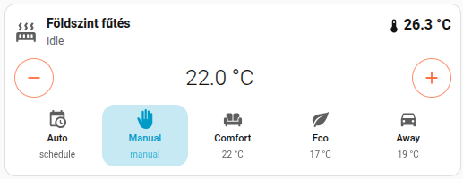
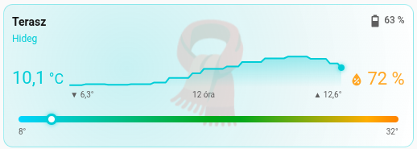
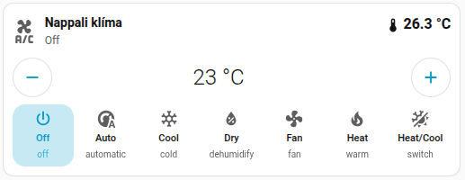

# GlowStat

Compact, glowing Home Assistant dashboard cards for thermometers, heating and air conditioners. The background
and the accents take the color of the current state, and everything is set up from the dashboard editor, no YAML
needed.

[](https://my.home-assistant.io/redirect/hacs_repository/?owner=forreggbor&repository=ha-GlowStat&category=plugin)

| Thermometer | Climate: heating |
|-------------|------------------|
|  |  |

| Thermometer, Hungarian texts | Climate: air conditioner |
|------------------------------|--------------------------|
|  |  |

## Cards

### `custom:glowstat-thermometer-card`

Temperature with a state-colored glow, humidity, battery, a temperature scale, a history graph and an animated
emoji in the background that follows the temperature (a penguin below 10 °C, a flame above 30 °C).
Tapping the humidity or battery value opens the history of that sensor, tapping anywhere else opens the temperature.

| Option | Description |
|--------|-------------|
| `entity` | Temperature sensor (required) |
| `humidity_entity` | Humidity sensor |
| `battery_entity` | Battery sensor |
| `name` | Card title, defaults to the entity name |
| `show_sparkline` | Show the history graph (default `true`) |
| `history_hours` | Length of the history graph in hours (default `24`) |
| `show_background_emoji` | Show the background emoji (default `true`) |
| `language` | `auto` (Home Assistant language), `hu` or `en` |

### `custom:glowstat-climate-card`

One card for heating and air conditioners: target temperature with `+` / `-`, the current temperature, the
state (heating, cooling, idle, off) and control buttons. The glow follows what the device is doing.

The control buttons are read from the entity itself, nothing is hard-coded. In the editor you pick them one by one
from every mode the entity offers: operating modes, presets, fan modes and swing modes, and you can reorder them.

| Option | Description |
|--------|-------------|
| `entity` | Climate entity (required) |
| `name` | Card title, defaults to the entity name |
| `icon` | Icon next to the title |
| `controls` | List of control buttons, see below. Without it the card shows the operating modes (more than two), otherwise the presets |
| `preset_temperatures` | Temperatures shown under preset buttons, e.g. `{comfort: 22, eco: 17}` |
| `language` | `auto` (Home Assistant language), `hu` or `en` |

A button is written as `<type>:<value>` where the type is `hvac_mode`, `preset_mode`, `fan_mode` or `swing_mode`.
To override the label, icon or subtitle of a button, use an object instead of a string:

```yaml
type: custom:glowstat-climate-card
entity: climate.living_room
controls:
  - hvac_mode:off
  - hvac_mode:cool
  - fan_mode:auto
  - type: preset_mode
    value: away
    name: Away
    icon: mdi:walk
    sub: save energy
```

## Installation

1. In Home Assistant open **Settings > Marketplace**, add `forreggbor/ha-GlowStat` as a custom repository of type
   dashboard (or use the button above), and download GlowStat.
2. Reload the browser (Ctrl+Shift+R).
3. Add a card and search for "GlowStat".

## Languages

Hungarian and English are built in. By default the card follows the Home Assistant language, the `language`
option overrides it per card.

## License

MIT, see [LICENSE](LICENSE).
